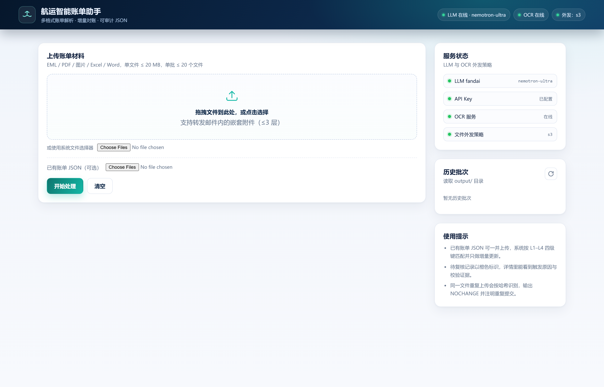
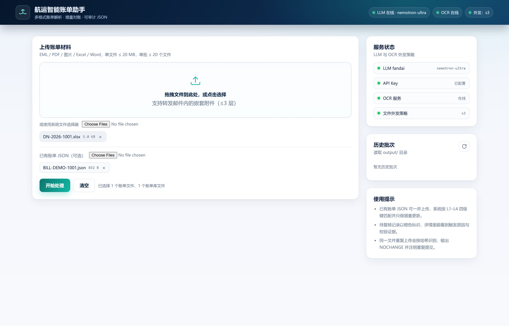
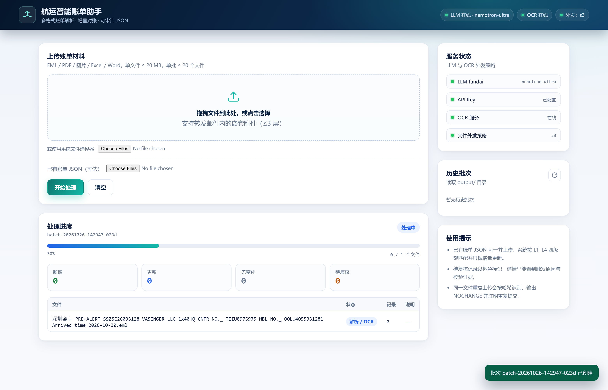
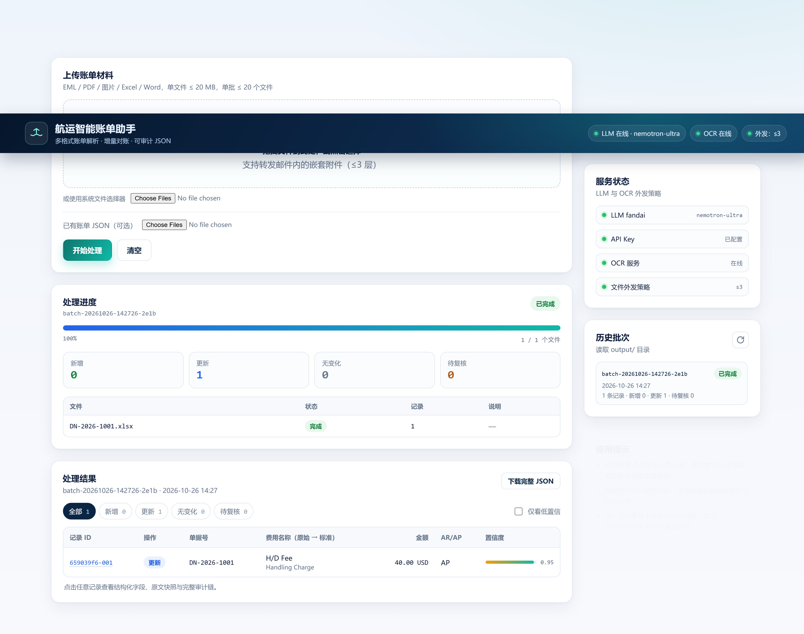
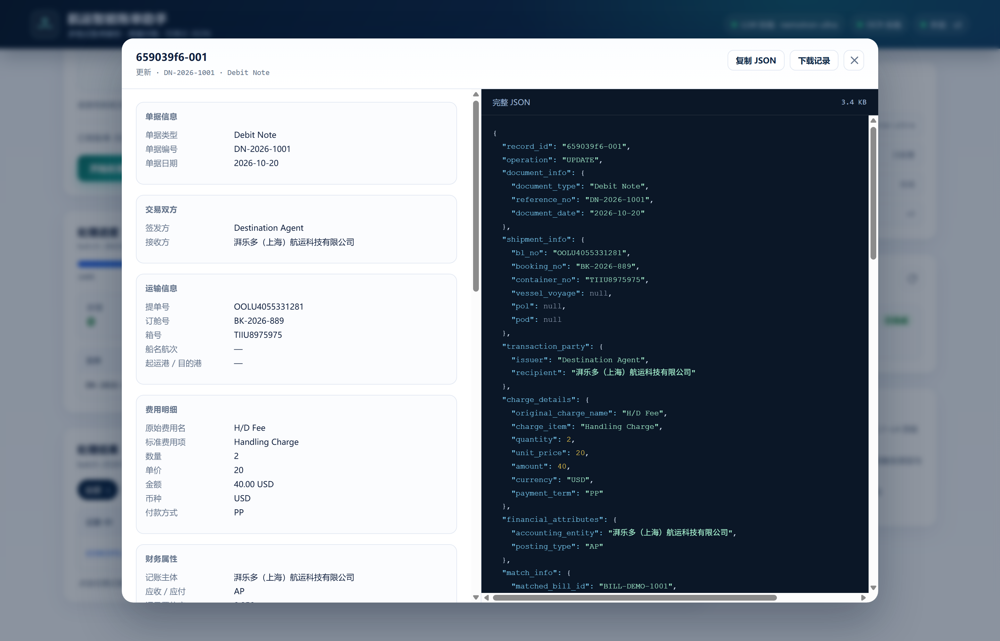

# 航运智能账单助手（Shipping Billing Agent）

> 多格式文档解析 · 增量对账 · 可审计 JSON —— 面向财务场景的航运账单智能体

把散落在 **EML / PDF / 图片 / Excel / Word** 里的航运费用，自动解析为标准 JSON，匹配已有账单并只做增量更新；每一步都留下可审计的来源、快照与推理依据。

技术栈：**Python 3.11+、LangChain / LangGraph、FastAPI、Pydantic v2**。前端为原生 HTML/CSS/JS，无构建工具链，克隆即运行。

> ⚠️ **运行前必须配置两类密钥**：① **LLM API Key**（语义提取的唯一入口，`LLM_API_KEY` 或 profile 专属变量）；② **OSS 对象存储 AK/SK**（扫描件/图片送 OCR 前的文件外发通道，`OSS_AK` / `OSS_SK`）。两者都只走 `.env` 环境变量，**严禁提交进仓库**。详见 [3.2 配置凭证](#32-第二步配置凭证必须llm-api-key--oss)。

## 目录

- [1. 能力一览](#1-能力一览)
- [2. 架构](#2-架构)
- [3. 启动教程（图文）](#3-启动教程图文)
- [4. Web 界面走读（截图演示）](#4-web-界面走读截图演示)
- [5. 配置说明](#5-配置说明)
- [6. REST API](#6-rest-api)
- [7. 数据契约](#7-数据契约)
- [8. Harness 质量工程](#8-harness-质量工程)
- [9. 目录结构](#9-目录结构)
- [10. 故障排查](#10-故障排查)
- [11. 已知边界](#11-已知边界如实说明)
- [12. 安全与合规](#12-安全与合规)
- [13. 验收与文档](#13-验收与文档)

---

## 1. 能力一览

| 能力 | 实现 |
| --- | --- |
| 多格式解析 | EML（正文 + 递归附件 ≤3 层）、文本型 PDF（pdfplumber）、扫描 PDF/图片（OCR API）、Excel（多工作表/表头偏移/合并单元格）、Word（DOCX 段落+表格，DOC 文本流降级） |
| 语义提取 | LangChain 结构化输出，LLM 只输出客观事实；温度 0；三级降级链 + 错误回喂重试 |
| 标准化 | 费用名别名/模糊归类、币种 ISO 4217、付款方式 PP/CC、OCR `0/O`、`1/I`、`5/S`、`8/B` 纠错、箱号 ISO 6346 校验位 |
| 匹配更新 | L1 单据号+费用名 → L2 提单号+费用名+币种 → L3 订舱号+… → L4 箱号+双方+日期±3天+金额；null 不覆盖、字段级 diff、冲突送复核 |
| AR/AP | 符号-类型正交矩阵；`CN × 接收方 × 负数 → AR` 双重反转陷阱有专门回归测试 |
| 幂等与防重 | 文件 SHA-256 + 历史账本；重复提交输出 NOCHANGE；同一批次 ID + `--deterministic` 可做到 byte-level 一致 |
| 输出 | 每费用一行、双字段费用名（原始 + 标准）、完整审计链、JSON Schema 校验后落盘 |
| 质量工程 | 146 个离线测试、11 个 golden 场景、9 项指标门禁、CI、失败注入、OCR/LLM 录制回放 |

---

## 2. 架构

```text
Web 上传 / CLI
   │
   ▼
ingest（SHA-256 去重 · 魔数探测）
   ▼
unpack（EML 递归解包 → 内容树）
   ▼
parse（Excel / Word / 文本 PDF / OCR 外发策略链）
   ▼
segment（按页/文档头/长度分块）
   ▼
extract ★ LLM 唯一节点（原始事实 + 行快照 + 置信度）
   ▼
normalize（费用名 / 币种 / 付款方式 / 单证号 / 日期 / 行快照溯源）
   ▼
validate（V1~V9 分币种勾稽、去重、汇总行过滤）
   ▼
arap（确定性决策矩阵 + 主体别名解析）
   ▼
match（L1→L4 短路 + 派生键 + 字段级 diff + 冲突检测）
   ▼
review（置信度门槛 / 复核原因路由）
   ▼
assemble（一对多展开 · 双字段费用名 · 审计模板句）
   ▼
output（batch.json / records.json / summary.json + status.json）
```

**职责边界**：LLM 只做“非结构化 → 结构化”；标准化、校验、AR/AP、匹配、diff、operation 判定全部是确定性代码，可单测、可回归、可解释。

关键代码：

- 状态机：`app/agent/graph.py`
- 契约：`app/extraction/schemas.py`
- LLM 接入：`app/extraction/llm_client.py`
- 字典：`app/governance/dicts/*.yaml`
- 匹配：`app/agent/nodes/match.py`
- 账单仓储（双 Schema + 派生键）：`app/storage/bills_repo.py`
- 外发策略链：`app/storage/file_exposer.py`
- Web：`app/server.py`、`app/web/static/`

---

## 3. 启动教程（图文）

### 3.0 准备清单

| 必须项 | 说明 |
| --- | --- |
| Python 3.11+ | 依赖 `langchain` / `langgraph` / `fastapi` / `pydantic v2` |
| **LLM API Key** | 语义提取唯一入口；`local_proxy` / `deepseek_official` / `openai` 或自建中转 profile 任选 |
| **OSS（S3 兼容对象存储）** | 扫描 PDF / 图片送 OCR 前的文件外发通道；没有 OSS 时见 [5.2 替代方案](#52-ocr-文件外发策略链重点) |
| 样例材料 | 仓库自带：`samples/generated/DN-2026-1001.xlsx`、`samples/bills/BILL-DEMO-1001.json` |

### 3.1 第一步：安装依赖

```bash
git clone <repo-url> && cd shipping-billing-agent
python -m venv .venv
# Windows
.venv\Scripts\activate
# Linux / macOS
# source .venv/bin/activate

pip install -r requirements.txt
cp .env.example .env          # Windows: copy .env.example .env
cp config.sample.yaml config.yaml   # 可选：config.yaml 属本地运行配置，不入库
```

> 离线跑测试不需要任何密钥：`conftest.py` 会把 `SBA_CONFIG` 指向入库的 `tests/config.test.yaml`，本地与 CI 用同一份配置。

### 3.2 第二步：配置凭证（必须：LLM API Key + OSS）

编辑 `.env`（已被 `.gitignore` 排除，**严禁提交真实密钥**）：

```bash
# ---- ① LLM API Key：语义提取的唯一入口，必须配置 ----
LLM_PROFILE=deepseek_official        # local_proxy | deepseek_official | openai | 自建 profile
LLM_API_KEY=sk-xxxx                  # 全局优先；profile 也可指定自己的变量（如 DEEPSEEK_API_KEY）
# LLM_BASE_URL=                      # 可选：覆盖 profile 地址
# LLM_MODEL=                         # 可选：覆盖 profile 模型

# ---- ② OSS 文件外发：扫描 PDF / 图片送 OCR 前必须先变成公网可回访的预签名直链 ----
OCR_EXPOSER=auto                     # auto 会按 S3 → 文件代理 自动探测
OSS_ENDPOINT=https://oss-cn-beijing.aliyuncs.com   # S3 兼容端点（阿里云 OSS / 腾讯云 COS / MinIO）
OSS_BUCKET=your-private-bucket                     # 必须私有桶
OSS_REGION=cn-beijing
OSS_AK=你的AccessKeyId               # 真正的密钥只放环境变量，配置文件里只有变量名
OSS_SK=你的AccessKeySecret
```

两项缺一不可的原因：

- **不配 LLM Key** → `extract` 节点（`app/extraction/llm_client.py`）无法调用，所有非结构化提取失败，批次直接不可用；
- **不配 OSS** → OCR 服务在公网，回访不到你本机的 `127.0.0.1/192.168.x.x`，扫描件与图片会被标记 `OCR_UNAVAILABLE` 送复核（文本型 PDF / Excel / Word / EML 不受影响）。没有 OSS 时可设 `FILE_PROXY_BASE_URL` 走自托管文件代理（B 级策略），见 [5.2](#52-ocr-文件外发策略链重点)。

配完先自检（不跑批次即可定位密钥问题）：

```bash
python -m app.tools.llm_selfcheck    # 真调 /models + 一次 chat completion
python -m app.tools.ocr_selfcheck    # 真调 OCR 健康检查 + 外发策略探测（应显示 selected=s3）
```

### 3.3 第三步：启动 Web 服务

```bash
# 默认读 config.yaml（生产/自有主体）
python -m app.server

# 演示推荐：SBA_CONFIG 指向样例配置，记账主体自动对齐样例单据，便于看到 AR/AP 判定
# Windows PowerShell
$env:SBA_CONFIG="config.sample.yaml"; python -m app.server
# Git Bash / Linux / macOS
SBA_CONFIG=config.sample.yaml python -m app.server
```

打开 **http://127.0.0.1:8000**。首页右上角与右侧「服务状态」卡会实时显示 LLM / API Key / OCR / 外发策略四项探活结果——**全绿即代表 3.2 的两类密钥都配置成功**：



### 3.4 第四步：CLI 批处理（可选）

```bash
python -m app.cli samples/original
python -m app.cli samples/generated --bills samples/bills
python -m app.cli samples/original --config config.sample.yaml
python -m app.cli samples/generated --bills samples/bills --json
```

常用参数：

| 参数 | 说明 |
| --- | --- |
| `--bills PATH...` | 已有账单 JSON 文件或目录 |
| `--batch-id ID` | 指定批次 ID（幂等测试/复现） |
| `--deterministic` | 固定时间戳（配合相同 batch-id 输出 byte-level 一致） |
| `--ignore-ledger` | 忽略历史哈希账本，强制重跑 |
| `--no-cache` | 禁用 LLM 响应缓存 |
| `--llm-profile` | `local_proxy` / `deepseek_official` / `openai` |
| `--config PATH` | 指定配置文件 |

---

## 4. Web 界面走读（截图演示）

以下截图来自真实运行：上传仓库自带样例 `DN-2026-1001.xlsx` + 已有账单 `BILL-DEMO-1001.json`，记账主体为样例配置中的「湃乐多（上海）航运科技有限公司」。

### 4.1 选择文件

拖拽或点选账单材料（EML/PDF/图片/Excel/Word，单文件 ≤20 MB、单批 ≤20 个，前端+服务端双重校验）；如有历史账单，放入「已有账单 JSON」区，系统会做 L1–L4 匹配并只输出增量更新。



### 4.2 处理进度

点「开始处理」后生成批次 ID，页面每 2 秒轮询 `/api/batches/{id}`：顶部进度条、新增/更新/无变化/待复核四个计数、逐文件的阶段状态（排队 / 解析 / OCR / 提取 / 判定 / 完成 / 失败 / 跳过）实时刷新。



### 4.3 结果列表

批次完成后自动切到「处理结果」：本例 1 条记录被判定为 **更新**——原始费用名 `H/D Fee` 映射为标准项 `Handling Charge`，金额 40.00 USD，AR/AP 判定 AP，置信度 0.95。支持按操作筛选、仅看低置信、下载整批 JSON。



### 4.4 记录详情与审计链

点击任意记录打开详情弹窗：左侧是单据信息、交易双方、运输信息、费用明细、财务属性、匹配信息（本例 L1 命中 `BILL-DEMO-1001`）、字段变更与完整处理依据；右侧是语法高亮的完整 JSON，可复制或单条下载。



### 4.5 历史批次

右侧「历史批次」读取 `output/` 目录，任意批次可回看点开复现；服务状态卡随时展示 LLM / OCR / 外发策略探活结果。

---

## 5. 配置说明

主配置：`config.yaml`；样例演示配置：`config.sample.yaml`；环境变量可覆盖关键项。
配置结构遵循《实现计划.md》§3.1。

### 5.1 LLM 多端点

```yaml
llm:
  profile: "local_proxy"
  profiles:
    local_proxy:       { base_url: "http://127.0.0.1:8788/v1", model: "deepseek-v4.1-flash" }
    deepseek_official: { base_url: "https://api.deepseek.com/v1", model: "deepseek-chat" }
    openai:            { base_url: "https://api.openai.com/v1",   model: "gpt-4o-mini" }
```

- `LLM_PROFILE` 切换 profile；`LLM_BASE_URL` / `LLM_MODEL` 覆盖地址与模型；
- `LLM_API_KEY` 全局优先，profile 也可配置自己的 `api_key_env`（如 `DEEPSEEK_API_KEY`）；
- 结构化输出降级链：`function_calling → json_mode → 提示词内嵌 Schema + Pydantic 校验 + 错误回喂（≤2 次）`；
- 响应缓存位于 `.cache/llm/`，key = `prompt_version + model + base_url + 字典版本 + sha256(输入)`；
- 温度固定 0。

### 5.2 OCR 文件外发策略链（重点）

OCR 服务在公网，**本机 127.0.0.1 / 192.168.x.x 它访问不到**。系统按策略链外发：

| 级别 | 策略 | 启用条件 | 说明 |
| --- | --- | --- | --- |
| A（首选） | 云对象存储预签名直链 | 配置 `OSS_ENDPOINT` / `OSS_BUCKET` / `OSS_AK` / `OSS_SK`（S3 兼容：阿里云 OSS、腾讯云 COS、MinIO） | 私有桶、TTL ≤30 分钟、OCR 完成即删对象 |
| B | 自托管文件代理 | 设置 `FILE_PROXY_BASE_URL`（部署机有公网 IP 或与 OCR 同内网） | FastAPI `GET /files/{token}/{filename}`，token 短 TTL |
| C | URL 直传 | 输入本身是 URL | 原样透传 |
| D（默认关） | 公共临时图床 | `OCR_TEMP_HOST_ENABLED=1` | 仅演示兜底，有数据外泄风险，开启会打印警告 |

- `OCR_EXPOSER=auto` 时按 A→B 探测；无可用策略时，**文本型 PDF 仍可本地解析**，扫描 PDF/图片按设计标记 `OCR_UNAVAILABLE` 送复核，不会拖垮整批；
- 启动时可用 `python -m app.tools.ocr_selfcheck` 真调探测；`/api/health` 展示当前策略；
- 生产建议：账单属财务敏感数据，使用自有账号私有桶，或部署到有公网 IP 的自有服务器走 B 级。

### 5.3 记账主体与口径

```yaml
accounting_entity:
  name: "Origin Agent"
  aliases: ["Origin Agent Co., Ltd.", "OA"]

arap:
  policy: "reversed_posting"   # 可选 same_account_offset
```

- 主体解析：别名 + 剥离 `Co., Ltd./Ltd/GmbH/公司` 等后缀 + 双向包含 + 相似度兜底；
- 无法对应 → `ENTITY_UNRESOLVED`；同时对应双方 → `SELF_TRADE`；均送复核；
- `same_account_offset`：Credit Note 不翻转科目，装配层将金额取负；
- PP/CC 与正文收费方向语句仅作佐证，矛盾送复核。

### 5.4 匹配与阈值

```yaml
matching:
  l4_enabled: true
  l4_to_review: true
  l4_allow_missing_container: true
  amount_tolerance: 0.01
  date_window_days: 3
  derived_keys_enabled: true

thresholds:
  review_below: 0.70
  low_confidence_below: 0.85
```

---

## 6. REST API

| 端点 | 方法 | 说明 |
| --- | --- | --- |
| `/api/batches` | POST | `files[]` + 可选 `bills[]`，返回 `batch_id` |
| `/api/batches` | GET | 历史批次 |
| `/api/batches/{id}` | GET | 状态 + 摘要 |
| `/api/batches/{id}/records` | GET | `?operation=UPDATE,PENDING_REVIEW`、`?low_confidence=true` |
| `/api/batches/{id}/export` | GET | 下载 `batch.json`（PRD 6.5 包装） |
| `/api/health` | GET | `?probe=1` 真调 OCR/LLM 连通性 |
| `/files/{token}/{filename}` | GET | B 级自托管文件代理（短 TTL） |

---

## 7. 数据契约

### 7.1 已有账单输入（双 Schema 兼容）

- **扩展格式**（PRD 6.2）：含 `shipment_info` + `charges[]`；
- **最小格式**（《要求.md》第五节）：扁平单费用记录，只有 `document_info` / `transaction_party` / `charge_details` / `financial_attributes` / `audit_trail`。

最小格式没有提单/订舱/箱号时，加载期会做**派生键重建**：

- `reference_no` 按提单号 / 箱号（ISO 6346 校验位确认）/ 订舱号模式探测；
- 扫描 `remarks` 与 `audit_trail` 文本挖掘编号；
- 派生键标记 `derived: true`，只用于 L2–L4；批报告输出匹配键覆盖率。

### 7.2 输出

单条记录字段见 PRD 6.3；每费用项目一条，`charge_details` 同时包含：

```json
{
  "original_charge_name": "H/D Fee",
  "charge_item": "Handling Charge",
  "amount": 40.0,
  "currency": "USD",
  "payment_term": "PP"
}
```

映射发生时，`audit_trail.ai_reasoning` 必含确定性模板句：

```text
原始费用名称 'H/D Fee' 已映射为标准费用项 'Handling Charge'
```

批产物：

```text
output/<batch_id>/
├─ batch.json      # 完整批包装（PRD 6.5）
├─ records.json    # 记录数组
├─ summary.json    # 摘要 + 文件结果 + 元数据
└─ status.json     # 实时进度（Web 轮询）
```

`output/ledger.json` 记录已处理文件哈希，用于重复提交识别与断点重跑。

---

## 8. Harness 质量工程

### 8.1 离线测试

```bash
pytest -q
```

覆盖：

- 解析：魔数错位、嵌套 EML 深度、HTML 表格、Excel 合并单元格/表头偏移、Word、文本 PDF、坏文件隔离；
- OCR：策略选择/清理、S3/代理/临时图床、重试/降级、低质量、响应结构归一；
- LLM：function calling、json mode、Schema 重试、连接失败、缓存命中；
- 标准化与校验：附录 A 全量映射、币种/付款方式、USO→USD、箱号校验位、日期歧义、分币种勾稽、去重、汇总行过滤；
- AR/AP：36 用例穷举，含 `CN × 接收方 × -40 → AR` 陷阱回归；
- 匹配：L1–L4、THC 别名、O→0、最小格式派生键、null 继承、冲突、歧义；
- 集成：多格式批、EML 附件根哈希、UPDATE、重复提交 NOCHANGE、idempotency、LLM/OCR 不可用、坏文件隔离、共享账单行歧义；
- API：上传→状态→筛选→导出→历史→静态页→404/400。

当前结果：**146 passed**。

### 8.2 Golden 评测（fixtures 离线）

```bash
python eval/make_fixtures.py       # 重新生成夹具（可选）
python eval/run_eval.py --fixtures
```

11 个场景覆盖：Excel 标准单、Word Credit Note 负数、PDF 更新、EML 附件、图片 OCR 录制回放、最小格式 L2 派生键、多币种、勾稽不平、主体无法对应、数据冲突、匹配歧义。

当前结果：

| 指标 | 结果 | 门限 |
| --- | --- | --- |
| 字段级 F1 | 1.000 | ≥ 0.95 |
| AR/AP 准确率 | 1.000 | ≥ 0.98 |
| 决策准确率 | 1.000 | ≥ 0.95 |
| 匹配级别准确率 | 1.000 | ≥ 0.90 |
| 记录数一致率 | 1.000 | ≥ 0.95 |
| JSON 合法率 | 1.000 | = 1.0 |
| 幻觉率 | 0.000 | = 0 |
| 非预期复核率 | 0.000 | ≤ 0.05 |
| 变更字段命中率 | 1.000 | = 1.0 |

报告写入 `eval/reports/`（JSON + Markdown）。黄金集故意包含 4 个对抗复核用例，因此整体 `review_rate` 只作信息展示，门禁使用 `unexpected_review_rate`。

### 8.3 CI

`.github/workflows/ci.yml`：安装依赖 → `pytest -q` → `python eval/run_eval.py --fixtures` → 两个 dry-run 自检。全流程无外部服务。

### 8.4 确定性与追踪

- 相同输入 + 相同 batch-id + `--deterministic` → `batch.json` byte-level 一致（有集成测试）；
- 所有 LLM/OCR 响应可按输入哈希缓存/录制，CI 回放；
- LangChain 支持可观测：设置 `LANGCHAIN_TRACING_V2=true` 与 `LANGCHAIN_API_KEY` 即可接入 LangSmith；不上云时用 `output/<batch>/audit_trail` 与 `status.json` 定位。

---

## 9. 目录结构

```text
shipping-billing-agent/
├─ app/
│  ├─ server.py / cli.py
│  ├─ config/settings.py
│  ├─ agent/
│  │  ├─ graph.py / state.py
│  │  └─ nodes/  ingest / unpack_eml / parse_* / ocr_client / segment / extract /
│  │             normalize / validate / arap / match / review / assemble
│  ├─ extraction/ schemas.py / llm_client.py / prompts/v1_extract.txt
│  ├─ governance/ dictionaries.py / ocr_fix.py / dicts/*.yaml
│  ├─ storage/ file_exposer.py / bills_repo.py / outputs.py / status.py
│  ├─ tools/ ocr_selfcheck.py / llm_selfcheck.py
│  └─ web/static/ index.html / style.css / app.js
├─ docs/images/            # README 截图
├─ eval/ golden/ + make_fixtures.py + run_eval.py + reports/
├─ tests/ unit/ + integration/ + fixtures/
├─ samples/ original/ + generated/ + bills/
├─ config.yaml / config.sample.yaml
├─ requirements.txt / pytest.ini
└─ .github/workflows/ci.yml
```

---

## 10. 故障排查

| 现象 | 原因 | 处理 |
| --- | --- | --- |
| 图片/扫描 PDF 全部 `OCR_UNAVAILABLE` | 本机无公网可达地址，A/B 策略未配置 | 配置 S3 兼容桶或公网代理；纯文本 PDF 不受影响 |
| `/api/health` 显示 OCR 在线但外发未配置 | 健康检查只测服务可达，不代表服务能回访本机 | 这是两件事：配置策略链并用 `ocr_selfcheck` 真调探测 |
| LLM 401 / 超时 | key 缺失或 profile 错误 | 检查 `LLM_API_KEY`、`LLM_PROFILE`、`LLM_BASE_URL`；用 `llm_selfcheck` |
| 所有记录 `PENDING_REVIEW` + `ENTITY_UNRESOLVED` | `accounting_entity` 与单据双方不匹配 | 修改 `config.yaml` 主体与别名；样例可用 `config.sample.yaml` |
| 重复上传输出 NOCHANGE | 文件哈希已存在于 `output/ledger.json` | 预期行为；强制重跑加 `--ignore-ledger` |
| `.doc` 表格结构丢失 | 旧 DOC 无纯 Python 结构化解析器，当前为文本流降级 | 提供 DOCX；解析质量会标记 `low` 并在审计中提示 |
| 中文路径/控制台乱码 | Windows 控制台编码 | 设置 `PYTHONIOENCODING=utf-8`；输出文件本身为 UTF-8 |
| 端口占用 | 8000 已被使用 | 修改 `config.yaml` 的 `web.port`，或关闭占用进程 |

---

## 11. 已知边界（如实说明）

1. **一次运行只支持一个记账主体**（PRD Q1）；多主体需分批次或改造配置。
2. **扫描件依赖公网文件外发**；无云桶/公网代理时，扫描 PDF 与图片只能送复核。文本型 PDF、Excel、Word、EML 不受影响。
3. **不做汇率折算**：只保留原币种，交由财务系统按记账时点汇率处理。
4. **`.doc` 旧格式**只做文本流抽取，表格结构可能丢失，建议 DOCX。
5. **方向语句佐证**基于关键词表，非自然语言理解；矛盾时送复核，不做静默改写。
6. **L4 弱键**默认命中即复核；同一已有账单费用行被多条输入命中时全部送复核。
7. **OCR 响应适配**为容错归一（文本/行/表格/坐标/置信度常见结构），若服务商返回全新结构，需在 `app/agent/nodes/ocr_client.py` 增加适配。
8. **无鉴权/多租户**：定位为本地或内网财务工具；对公网部署需自行加反向代理鉴权与 HTTPS。
9. **上传原件与产物默认保留**：`data/uploads/`、`output/`；生产环境需配置清理策略与访问控制。
10. **LLM 成本/延迟**：默认快速档模型；复杂多页表格可经 `LLM_MODEL` 零代码切换更强模型，并用 golden 集回归。

---

## 12. 安全与合规

- 云桶必须私有 + 预签名短 TTL + OCR 完成即删；公共临时图床默认关闭；
- AK/SK、LLM key 只走环境变量，仓库中无硬编码密钥；
- 上传文件名净化，防止路径穿越；`.json` 账单与账单文件分开存储；
- EML 只做 MIME 解析，不加载外部资源、不执行宏/脚本；HTML 解析忽略 `script/style`；
- 输出审计链包含来源文件、SHA-256、邮件元数据、原文快照、匹配/更新/AR-AP 依据，满足财务复核与追溯；
- 账单数据默认只发送到所配置的 LLM 与 OCR 端点；切换官方公网 profile 意味着文本出网，需使用方确认合规。

---

## 13. 验收与文档

- 验收自查表（AC-1~AC-11 逐项证据）：`../docx/验收自查表.md`
- 基于 Web 的演示脚本：`../docx/演示脚本.md`
- 交付说明与执行记录：`../docx/交付说明.md`
- 原始需求与设计：《要求.md》《PRD.md》《实现计划.md》（上级目录）

```bash
# 最终复验
pytest -q
python eval/run_eval.py --fixtures
python -m app.tools.ocr_selfcheck --dry-run
```
